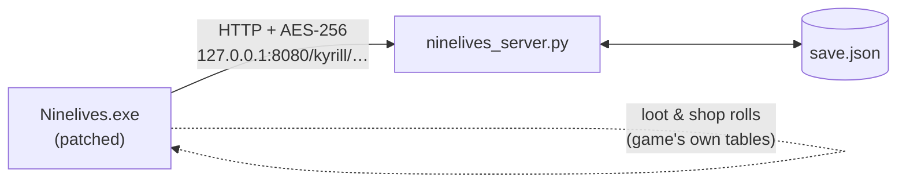

<div align="center">

# 🐾 Nine Lives — Offline Server

**Play SmokymonkeyS' suspended open-world RPG *Ninelives* again, entirely on your own PC.**


-d97757)

</div>

> [!NOTE]
> **This project was made with AI.** The server, the patcher, the protocol write-up and
> this README were written by Anthropic's Claude (in Claude Code) working from the game's
> own files, then tested by a human playing the game. See [About the AI](#-about-the-ai).

---

## 📖 What is this?

*Ninelives* was a free online RPG by the two-person studio **SmokymonkeyS** (2015–2016).
Development was suspended, the official servers went quiet, and the game can no longer get
past its login screen.

This project brings it back for single-player, offline play:

- 🖥️ **A stand-in server** that runs on your PC and answers everything the game asks for:
  login, characters, items, bank, skills, quests, alchemy and the Scarab Gem shop.
- 🔧 **A small patcher** that points the game at `127.0.0.1` instead of the dead server.
- 💾 **Your saves stay on your PC** in one readable `save.json` file.
- 🚫 **Nothing goes out to the internet.** The game's Google Analytics pings are redirected
  to the local server as well.
- 🎲 **Real loot.** The game has offline drop and shop tables built in. The patch switches
  them on, so drops come from the game's own data.
- 🧩 **A mod loader.** Drop mod DLLs into a `Mods` folder and change the game with
  [Harmony](https://harmony.pardeike.net/). See **[MODDING.md](MODDING.md)**.

## ✅ Requirements

| You need | Why |
|---|---|
| Your own copy of **Ninelives 0.24.3** for Windows | This repo contains **no game files**. |
| [Python 3.8+](https://www.python.org/downloads/) | Runs the server. No packages to install. |
| [.NET 8 SDK](https://dotnet.microsoft.com/download) | Only to run the patcher once. |

## 🚀 Quick start

1. **Download** this repo (green **Code** button → *Download ZIP*) and unzip it **next to**
   your game folder:

   ```
   SomeFolder\
   ├── Ninelives\              ← your game (holds Ninelives.exe)
   └── offline-server\         ← this repo
   ```

   Game somewhere else? Open the two `.bat` files in Notepad and change `GAME_DIR`.

2. **Patch the game** (once): double-click **`Patch Game.bat`**.
   It backs up the original files first and checks they're the right version.

3. **Play:** double-click **`Start Nine Lives.bat`**. It opens the server window, then the game.
   Log in with **any email and password**. Your account is created on the spot.

Keep the server window open while you play.

### Undo

Run `Patch Game.bat restore`. The untouched originals are kept in
`Ninelives\Ninelives_Data\OfflineBackup\`.

## ⚙️ How it works



The game talks to its server with plain HTTP. Each request is an AES-256-encrypted JSON
blob, using a key built into the game. The server decrypts the request, updates
`save.json` and sends back exactly the reply the game expects.

The patcher makes three small edits with [Mono.Cecil](https://github.com/jbevain/cecil):

| File | Change |
|---|---|
| `Assembly-UnityScript.dll` | Server address → `127.0.0.1:8080` |
| `Assembly-UnityScript.dll` | `VersionDefine.offlineItemDrop = true` (local loot tables) |
| `Assembly-CSharp-firstpass.dll` | Google Analytics URL → the local server |
| `Assembly-UnityScript.dll` | Calls the mod loader once at startup |

The full request and reply format is documented in **[PROTOCOL.md](PROTOCOL.md)**. Anyone
who wants to write their own server (in Rust, Go, anything) has a complete spec.

## 🗂️ What's in here

| File | What it is |
|---|---|
| `ninelives_server.py` | The offline server (Python standard library only) |
| `aes.py` | Pure-Python AES-256-CBC, checked against the official FIPS-197 test vector |
| `patcher/` | The patcher (C#, .NET 8, Mono.Cecil) |
| `modloader/` | The mod loader the patcher installs (C#, .NET 3.5) |
| `mods/ExampleMod/` | A starter mod to copy |
| `Patch Game.bat` | Patches the game and installs the mod loader (or `restore` to undo) |
| `Start Nine Lives.bat` | Starts the server, then the game |
| `PROTOCOL.md` | Every server request and reply the game uses |
| `MODDING.md` | How to make mods |

## 🧩 Modding

The patch also installs a small mod loader. Mods are .NET DLLs in `Ninelives\Mods\`
that change the game's code at runtime with Harmony, so game files never get edited by hand.
Copy [`mods/ExampleMod`](mods/ExampleMod) to get started. The full guide is in
**[MODDING.md](MODDING.md)**.

## 🐞 Known issues

- **Alchemy vendors show no recipes.** The recipe lists only ever lived on SmokymonkeyS'
  servers and aren't in the game files. If you have records of the old recipes (screenshots,
  wiki pages, archived posts), please open an issue so they can be rebuilt.

## 🛠️ Tweaks

Settings at the top of `ninelives_server.py`:

| Setting | Default | What it does |
|---|---|---|
| `START_GEMS` | `100000` | Scarab Gems for new accounts (the old real-money shop currency) |
| `CHARACTER_LIMIT` | `8` | Character slots per account |
| `PORT` | `8080` | Must stay 8080 unless you also change the patcher |

Run `python ninelives_server.py -v` for a detailed log of every request. Passwords are never logged.

## ❓ FAQ

<details>
<summary><b>Can I bring over my character from the old live servers?</b></summary>

No. Those characters lived on SmokymonkeyS' servers, and that data is gone. You start fresh.
</details>

<details>
<summary><b>Does this work with other versions of the game?</b></summary>

It was written for **0.24.3**, the last release. The patcher checks the files and refuses
to patch anything else.
</details>

<details>
<summary><b>"Network error" in game</b></summary>

The server isn't running. Close the game and start it again with `Start Nine Lives.bat`,
and keep the black server window open.
</details>

<details>
<summary><b>Is the Scarab Gem shop free now?</b></summary>

The shop still charges gems, but nobody can buy gems anymore, so new accounts start with
100,000. Change `START_GEMS` if you'd rather earn your way.
</details>

## 🤖 About the AI

This project was built in one session by **Claude** (Anthropic), using Claude Code, at the
request of a player who wanted to keep the game alive. Claude:

- decompiled the game's .NET code to understand how it talks to its server,
- documented the protocol and wrote the server, the AES code, the patcher and the mod loader,
- tested the server with scripted requests, then fixed the bugs found when a human played
  through login, character creation and loading back in.

The human chose what to build, played the game and reported problems. Treat it like any
community fan project: it works for the people who've tried it, but it hasn't had wide testing.
Please open an issue if something breaks.

## ⚖️ Legal

- *Ninelives* and all its files, code and art belong to **SmokymonkeyS**. This repository
  contains **none** of them. You need your own copy of the game.
- This is an unofficial, non-commercial preservation project with no connection to SmokymonkeyS.
  If you're from SmokymonkeyS and want something changed, please open an issue.
- The code in this repository is released under the [MIT License](LICENSE).

<div align="center">
<sub>Made for preservation, with love for a game that deserved more time. 🐈</sub>
</div>
